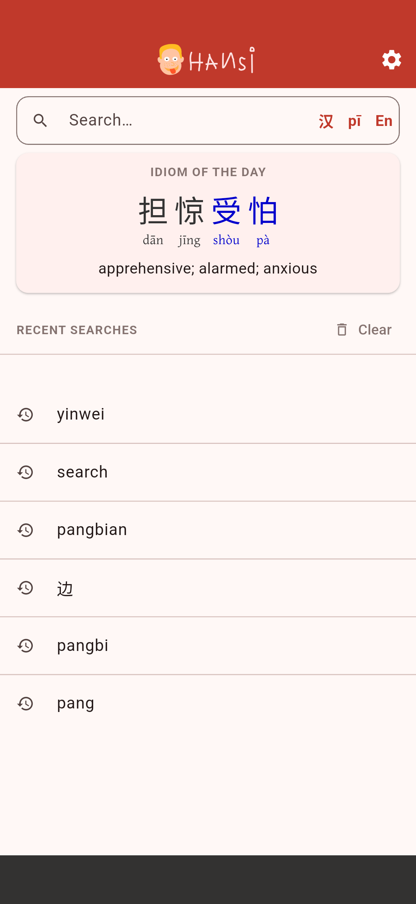
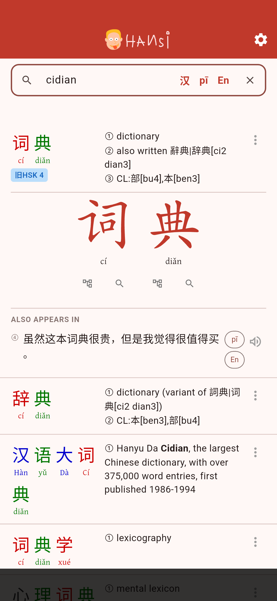
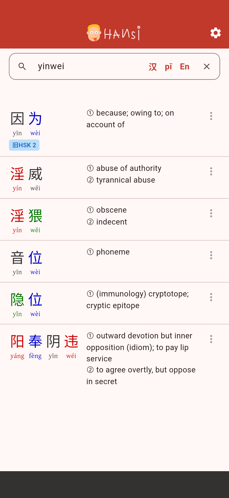

<p align="center">
  
</p>

A free, open-source Chinese–English dictionary for Android, built with
Flutter. Search by characters, pinyin (with or without tones) or English;
see stroke order, character decomposition and example sentences; send words
to AnkiDroid. Everything works offline: the app has no internet permission.

<p align="center">
  
  
  
</p>

Hansi is slopcoded: most of its code was written together with an AI agent,
and its example sentences were generated by one.

## Text-to-speech

"Listen" uses Android's system text-to-speech engine; Hansi ships no voice
of its own. You need an engine with a Chinese (Mandarin) voice, which many
de-Googled phones lack. Free options on F-Droid include **ChineseTtsTflite**
and **SherpaTTS** (install its Chinese language pack). Pick the engine under
*Settings → System → Languages → Text-to-speech output* and test it there
with "Play"; if that is silent in Chinese, Hansi will be too.

## License

The app's source code is licensed under the GNU Affero General Public License
v3.0 or later (AGPL-3.0-or-later); see [COPYING](COPYING).

## Bundled data and fonts

| Asset | Source | License |
|---|---|---|
| `assets/cedict.txt.gz` | [CC-CEDICT](https://cc-cedict.org), © MDBG and contributors | CC BY-SA 4.0 |
| `assets/word_freq.tsv.gz` | SUBTLEX-CH word frequencies (Cai & Brysbaert, 2010, PLOS ONE 5(6): e10729) | CC BY 4.0 |
| `assets/graphics.txt.gz` | Stroke graphics from [Make Me a Hanzi](https://github.com/skishore/makemeahanzi) | Arphic Public License |
| `assets/mma_dict.txt.gz` | Decomposition and etymology data from [Make Me a Hanzi](https://github.com/skishore/makemeahanzi) | CC BY-SA 4.0 |
| `assets/example_sentences.json` | Generated by the author with Claude (Anthropic), segmented with jieba | CC BY-SA 4.0 |
| `assets/hsk_levels.tsv` | Old HSK (2.0) levels 1–6, generated from [complete-hsk-vocabulary](https://github.com/drkameleon/complete-hsk-vocabulary) by Yanis Zafirópulos | MIT |
| `assets/fonts/GentiumPlus-*.ttf` | Gentium Plus, SIL International | SIL OFL 1.1 |
| `assets/fonts/NotoSansSC-*.ttf`, `NotoSerifSC-*.ttf` | Noto CJK, Google & Adobe | SIL OFL 1.1 |
| `assets/fonts/MaShanZheng-*.ttf`, `ZhiMangXing-*.ttf`, `ZCOOLXiaoWei-*.ttf` | Google Fonts | SIL OFL 1.1 |

How each file is produced, and what the app builds from them at startup,
is described in [docs/DATA.md](docs/DATA.md).

## Building

```
flutter build apk --release
```

Gradle 8.14 does not run on Java 25; point Flutter at JDK 17 or 21 if needed
(`flutter config --jdk-dir=/usr/lib/jvm/java-21-openjdk-amd64`).
